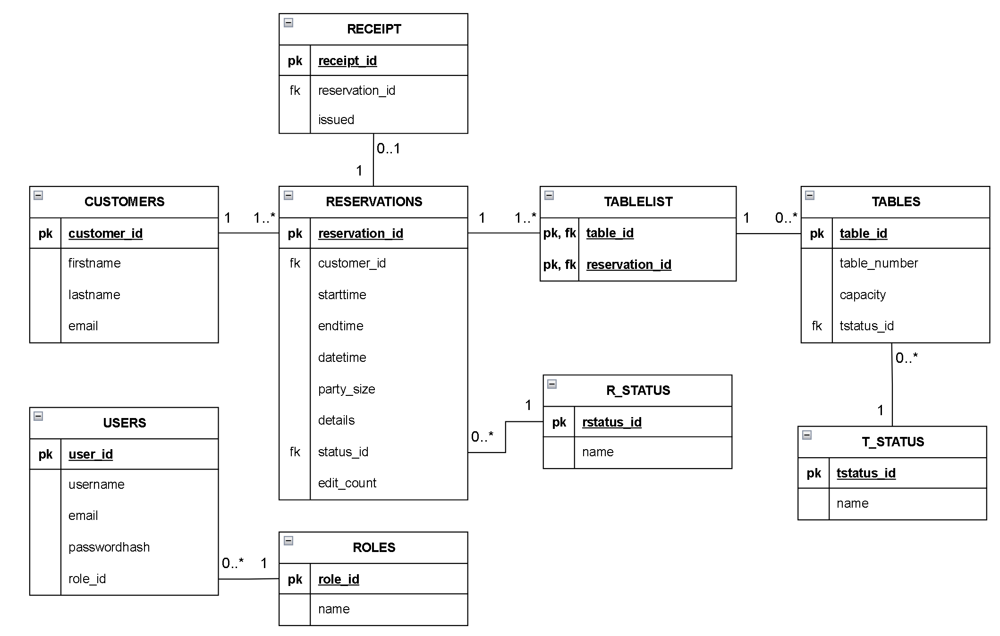

# Ohjelmistoprojekti 2 -kurssityö syksy 2026

[](https://github.com/TiimiPANTS/pants/actions/workflows/github-actions-demo.yml)
[](https://github.com/TiimiPANTS/pants/actions/workflows/github-actions-demo.yml)

[](https://openjdk.org/)
[](https://spring.io/projects/spring-boot)
[](https://react.dev/)
[](https://www.typescriptlang.org/)
[](https://recharts.org/)
[](https://www.postgresql.org/)
[](https://www.h2database.com/)

[](https://swagger.io/)
[](https://junit.org/)
[](https://site.mockito.org/)
[](https://github.com/features/actions)
[](https://playwright.dev/)
[](https://mailtrap.io/)

[](https://pants-backend.2.rahtiapp.fi)
[](https://pants-frontend.onrender.com)


📋 **Backlog:** [GitHub Projects](https://github.com/orgs/TiimiPANTS/projects/1)

🎯 **Retrospektiivit:** [Miro-taulu](https://miro.com/app/board/uXjVHqNZkTk=/?share_link_id=954013309038)

⭐ **API-dokumentaatio:** [Swagger UI](https://pants-backend.2.rahtiapp.fi/swagger-ui/index.html)

Alkuperäinen projektisuunnitelma ja muu dokumentaatio löytyy [docs-kansiosta](docs/). Kaikki 25 käyttäjätarinaa ja kehityskohteet löytyvät [backlogilta](https://github.com/orgs/TiimiPANTS/projects/1).

Projektin koodaukseen ja dokumentointiin on pääosin käytetty GitHub Copilotin ilmaista opiskelijalisenssiä. Osalla ryhmän jäsenistä oli käytössä Claude Pro- tai Codex Plus -tilaus (noin 22 €/kk). Lisäksi hyödynsimme Googlen Stitchiä käyttöliittymän suunnitteluun ja ElevenLabsia videon selostukseen. Selostuksen tekstin kirjoitimme itse.

---

❤️ **Kokeile sovellusta tietokoneella tai puhelimella:** https://pants-frontend.onrender.com

(YOUTUBE VIDEOLINKKI DEVISSÄ)

---

👖 **Ryhmä:** Pants
- Phong Nguyen ([PhongNgvyen](https://github.com/PhongNgvyen))
- Arttu Inkala ([archiartt](https://github.com/archiartt))
- Ngan Tran ([ng4nt](https://github.com/ng4nt))
- Thomas Obeng ([bhu629](https://github.com/bhu629))
- Sara Junnila ([sawasda](https://github.com/sawasda))

*Suluissa GitHub-käyttäjänimet ja linkit profiileihin.*

---

**Projektin nimi:** Ravintolan pöytävarausjärjestelmä

**Kuvaus:** Toteutimme kuvitteelliselle Le Pants -ravintolalle pöytävarausjärjestelmän verkkosovelluksena Scrum-viitekehystä noudattaen.

**Tavoite:** Toteutettava sovellus on verkkopohjainen pöytävarausjärjestelmä, jonka avulla asiakkaat voivat tarkistaa vapaat ajat sekä tehdä, muokata ja perua varauksia itsenäisesti ilman ravintolan henkilökunnan apua. Järjestelmän tavoitteena on vähentää puhelimitse ja muiden kanavien kautta tehtävää manuaalista työtä, ehkäistä virheitä ja parantaa yleistä asiakaskokemusta tehostamalla varausten hallintaa.

**Tärkeimmät ominaisuudet:**
Sovelluksen ensimmäisessä versiossa (MVP) asiakas voi:
- tarkastella ravintolan tietoja, aukioloaikoja ja yhteystietoja
- nähdä vapaat varausajat, jotta sopivan ajankohdan valitseminen on helppoa
- varata pöydän valitulle henkilömäärälle
- muokata varaustaan ennen varauksen ajankohtaa
- perua varauksensa, jolloin aika vapautuu muiden käyttöön
- saada onnistuneesta varauksesta vahvistuksen sähköpostiin

---

### **Teknologiat ja kirjastot**

**Backend** (Java 21, Spring Boot 4.1.1, Maven)
- **Spring Web MVC:** REST-rajapinnat
- **Spring Data JPA:** tietokantakäsittely (H2 paikallisesti, PostgreSQL tuotannossa)
- **Spring Security + OAuth2 Resource Server:** kirjautuminen ja JWT-pohjainen autentikointi
- **Spring Validation:** syötteiden validointi (Jakarta Bean Validation)
- **Spring Mail:** varausvahvistusten sähköpostit (Mailtrap)
- **springdoc-openapi:** Swagger-dokumentaatio API:lle
- **JUnit 6, Mockito, AssertJ:** testaus

**Frontend** (React 19, TypeScript 6, Vite)
- **React Router:** sivujen reititys
- **Tailwind CSS 4:** tyylit
- **DayPicker:** päivämäärän valinta varauslomakkeessa
- **Recharts:** kaaviot analytiikkasivulla
- **Playwright:** E2E-testaus

---

### **Projektin kansiorakenne**

```text
<projektin juuri>/
├── .github/workflows/        # GitHub Actions CI: backend- ja frontend-testit
├── backend/                  # Spring Boot -backend (Java 21, Maven)
│   └── src/
│       ├── main/
│       │   ├── java/com/pants/backend/
│       │   │   ├── config/       # Asetukset: tietoturva, JWT, CORS, Swagger
│       │   │   ├── controller/   # REST-rajapinnat
│       │   │   ├── dto/          # Tiedonsiirto-oliot pyynnöille ja vastauksille
│       │   │   ├── entity/       # JPA-entiteetit eli tietokantataulut
│       │   │   ├── repository/   # Tietokantakyselyt (Spring Data JPA)
│       │   │   └── service/      # Sovelluslogiikka
│       │   └── resources/
│       │       ├── templates/              # Sähköpostipohjat
│       │       ├── application*.properties # Ympäristökohtaiset asetukset
│       │       ├── H2_testdata.sql         # H2-tietokannan testidata
│       │       └── Pukki_Postgres_DDL.sql  # PostgreSQL-tietokannan rakenne
│       └── test/java/com/pants/backend/    # JUnit- ja Mockito-testit
├── frontend/                 # React + TypeScript -frontend (Vite)
│   ├── public/               # Staattiset tiedostot
│   ├── src/
│   │   ├── assets/           # Logo ja kuvat
│   │   ├── components/       # Uudelleenkäytettävät komponentit
│   │   ├── hooks/            # Omat React-hookit
│   │   ├── pages/            # Sovelluksen sivut
│   │   ├── services/         # API-kutsut backendiin
│   │   ├── styles/           # CSS ja Tailwind-määrittelyt
│   │   ├── types/            # TypeScript-tyypit
│   │   └── utils/            # Apufunktiot
│   └── tests/                # Playwright E2E -testit
├── docs/                     # Dokumentaatio: arkkitehtuuri, ERD, design-säännöt, testidokumentaatio, projektisuunnitelma
├── Dockerfile                # Backendin Docker-image (Rahti)
└── README.md
```

---

### **Projektin arkkitehtuuri**

Tarkempaa tietoa arkkitehtuurista ja tietokannasta löytyy tiedostosta [ARCHITECTURE.md](docs/ARCHITECTURE.md).



---

### **Projektin ja testien käynnistäminen paikallisesti**

**Vaatimukset:** Java 21 ja Node 22

Tarvitset kaksi terminaalia: toisessa pyörii backend ja toisessa frontend. Kaikki komennot ajetaan projektin juurikansiosta (kansio, johon kloonasit repon ja jossa on `backend`- ja `frontend`-kansiot).

#### 1. Ympäristömuuttujat

Frontend lukee backendin osoitteen `.env`-tiedostosta. Luo `.env`-tiedosto projektin juurikansioon (samaan kansioon kuin tämä README, ei `frontend`-kansioon):
```env
VITE_BACKEND_URL=http://localhost:8080
```

Backend tarvitsee `JWT_SECRET`-ympäristömuuttujan (Base64, vähintään 32 tavua). Backend ei lue `.env`-tiedostoa, joten aseta muuttuja samassa terminaalissa, jossa käynnistät backendin tai backend-testit. Muuttuja on voimassa vain siinä terminaalissa, joten aseta se uudelleen aina, kun avaat uuden terminaalin:

Windows (PowerShell):
```powershell
$env:JWT_SECRET = [Convert]::ToBase64String((1..32 | ForEach-Object { Get-Random -Maximum 256 }))
```

macOS/Linux:
```bash
export JWT_SECRET=$(openssl rand -base64 32)
```

#### 2. Backend (terminaali 1)

Windows (PowerShell):
```powershell
cd backend
.\mvnw.cmd spring-boot:run
```

macOS/Linux:
```bash
cd backend
./mvnw spring-boot:run
```

Backend on valmis, kun lokiin tulee rivi `Started BackendApplication`. Se toimii osoitteessa http://localhost:8080 ja API-dokumentaatio osoitteessa http://localhost:8080/swagger-ui/index.html.

Oletusasetukset (`application.properties`) käyttävät H2-muistitietokantaa testidatalla eivätkä ne ole yhteydessä Mailtrapiin. Tietokanta tyhjenee ja testidata palautuu aina, kun backend käynnistetään uudelleen. Jos tarvitset sähköpostit tai PostgreSQL:n, pyydä `application-local.properties`-tiedosto ryhmältä ja käynnistä backend `local`-profiililla. Tällöin `JWT_SECRET`-muuttujaa ei tarvita, koska se on määritelty tiedostossa:
- Windows (PowerShell): `.\mvnw.cmd spring-boot:run "-Dspring-boot.run.profiles=local"`
- macOS/Linux: `./mvnw spring-boot:run -Dspring-boot.run.profiles=local`

#### 3. Frontend (terminaali 2)

```bash
cd frontend
npm install
npm run dev
```

Avaa selaimessa http://localhost:5173.

*HUOM! `npm install` ajetaan vain ensimmäisellä kerralla. Sen jälkeen riittää `npm run dev`. Jos muutat `.env`-tiedostoa, käynnistä `npm run dev` uudelleen.*

---

#### Backend-testit

Aseta ensin `JWT_SECRET` (ks. kohta 1), koska osa testeistä käynnistää koko Spring-sovelluksen.

Windows (PowerShell):
```powershell
cd backend
.\mvnw.cmd --batch-mode --no-transfer-progress test
```

macOS/Linux:
```bash
cd backend
./mvnw --batch-mode --no-transfer-progress test
```

---

#### Frontend-testit

Käynnistä ensin backend perusasetuksilla (kohta 2), koska osa Playwright-testeistä käyttää oikeaa backendia ja sen testidataa. Frontendia ei tarvitse käynnistää, koska Playwright käynnistää sen automaattisesti. Aja testit toisessa terminaalissa:

```bash
cd frontend
npm install
npx playwright install
npm test
```

*HUOM! `npm install` ja `npx playwright install` ajetaan vain ensimmäisellä kerralla. Sen jälkeen riittää `npm test`.*

---

### **Automatisoidut testit**

**Backend** (JUnit 6, Mockito, AssertJ, Spring Boot Test), yli 100 testiä:
- **Controller-testit:** REST-controllereiden vastaukset (statuskoodit ja sisältö) asiakkaille, varauksille, pöydille ja pöytävarauksille sekä virheidenkäsittely. Riippuvuudet on mockattu Mockitolla.
- **Service-testit:** varauslogiikka ja pöytien kapasiteetin ja saatavuuden laskenta yksikkötesteinä.
- **Integraatiotestit:** pöytien varaaminen `@SpringBootTest`-testeillä oikeaa Spring-kontekstia ja H2-tietokantaa vasten.
- **DTO-validointi:** Jakarta Bean Validation -säännöt.

**Frontend** (Playwright, TypeScript), noin 68 E2E-testiä, jotka ajetaan Chromiumissa, Firefoxissa ja WebKitissä:
- varauksen tekeminen, muokkaaminen ja peruminen asiakkaana ja adminina
- kirjautuminen sekä käyttäjien lisääminen ja muokkaaminen
- koko varauksen elinkaari oikeaa backendia vasten

Osa testeistä korvaa API-kutsut mock-vastauksilla (`page.route`), osa käyttää käynnissä olevaa backendia.

Testit ajetaan automaattisesti **GitHub Actionsissa** jokaisella pushilla ja pull requestilla. Tarkempi testidokumentaatio löytyy [docs-kansiosta](docs/).

---

### **Lisenssi**

Projekti on lisensoitu MIT-lisenssillä. Katso [LICENSE](LICENSE).
